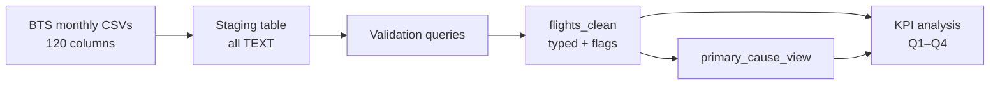

# U.S. Airline Delay & Cancellation Analysis (PostgreSQL)

A SQL project analyzing a full year of U.S. flight data from the Bureau of Transportation Statistics (BTS) to find **what actually drives delays and cancellations** and where operational fixes would have the most impact.

**Tools:** PostgreSQL · pgAdmin 4 · SQL (CTEs, views, window functions, PL/pgSQL)  
**Data:** BTS Marketing Carrier On-Time Performance, January–December 2025, 10 marketing carriers  

---

## Key findings

| Primary delay cause | % of delayed flights | Avg delay (min) | Total minutes lost |
| --- | ---: | ---: | ---: |
| Late Aircraft | 38.9% | 80.4 | 52,768,128 |
| Carrier | 29.4% | 78.7 | 38,969,514 |
| Air Traffic System (NAS) | 27.4% | 53.0 | 24,477,024 |
| Weather | 4.1% | 119.9 | 8,333,762 |
| Security | 0.2% | 51.1 | 147,553 |

1. **Most delay time is within the airline's control.** Late Aircraft and Carrier causes account for 68.3% of delayed flights and about 74% of all delay minutes. Weather is the most severe per incident (119.9 min) but only 4.1% of delays and about 7% of minutes lost.
2. **Raw counts mislead.** American has the most Late Aircraft delays (~202K) simply because it flies the most. Rated against each carrier's own flights, two of the smallest carriers are worst: Frontier (12.54%) and Allegiant (11.30%). Spirit (5.00%) and Delta (5.78%) are best.
3. **A fair comparison barely moves the on-time ranking.** Keeping only routes flown by 2+ carriers, Frontier stays last. United moves from 6th to 4th because Southwest and Alaska do worse on contested routes, not because United improved. About 90% of Allegiant's network has no direct competitor, so its on-time score can't be fairly benchmarked.
4. **Weather drives cancellations, not delays.** Weather is 4.1% of delayed flights but 74.9% of American's cancellations and 58.7% of Allegiant's. American's weather cancellations are concentrated at DFW (19.2%; top 5 airports 46.6%) and peak in January and July.
5. **Problem airports:** mountain-resort airports (ASE, EGE), where weather causes 14.7% of delays (~3.6x the system rate) though Carrier is still the #1 cause, and Allegiant's leisure airports (SFB, PIE, LCK).

**Recommendations:** add schedule buffer for Frontier and Allegiant in June–July and December; weather-contingency and de-icing capacity for mountain airports; weather-contingency planning for American at DFW and its other top cancellation airports.

Full write-up: [`docs/findings_summary.md`](docs/findings_summary.md)

---

## Pipeline



| Step | Script | What it does |
| --- | --- | --- |
| 1. Stage | [`01_create_staging_table.sql`](sql/01_create_staging_table.sql) | Loads every raw column as `TEXT` so the import can't fail on bad values and the source stays untouched |
| 2. Validate | [`02_validation.sql`](sql/02_validation.sql) | Row count (644,987 for Dec 2025), date range, duplicate flags, cancellation codes, airport counts, sample rows |
| 3. Clean | [`03_create_flights_clean.sql`](sql/03_create_flights_clean.sql) | Casts to `DATE` / `INTEGER` / `BOOLEAN`; builds route, cancelled, diverted, delayed-15+, severe-60+, on-time and departure-period flags |
| 4. Scale | [`04_load_all_months.sql`](sql/04_load_all_months.sql) | PL/pgSQL loop loads all 12 months, printing staged and inserted row counts per month; safe to re-run |
| 5. Analyze | [`05_kpi_analysis.sql`](sql/05_kpi_analysis.sql) | Full-year validation checks (row counts, month coverage, duplicates, reconciliation; results recorded in the file), the primary-cause view, then four question groups using CTEs, joins, `HAVING`, `UNION ALL` and window functions |

### Techniques worth noting

- **Share of total with a window function:** `100.0 * COUNT(*) / SUM(COUNT(*)) OVER (PARTITION BY marketing_carrier)` so each carrier's cancellation reasons sum to 100%.
- **Primary delay cause:** `GREATEST()` across the five BTS cause columns, labeled with `CASE`, saved once as a view.
- **Fair comparison:** a CTE keeps only routes flown by 2+ carriers, then joins back to the flight table.
- **Rates, not counts:** `LEFT JOIN` + `COALESCE` keeps carriers with zero events in the denominator.
- **Minimum sample sizes:** `HAVING COUNT(*) >= 500` for routes and `>= 1000` for airports.

### Handling a source schema change

Midway through the project BTS stopped serving the pipe-delimited ASCII layout. Every download became a 120-column quoted CSV: dates changed from `YYYYMMDD` to `YYYY-MM-DD`, numbers arrived as `"4.00"`, and the `form_type` field disappeared. I rebuilt the staging table, cast through `::NUMERIC` before `::INTEGER`, updated the date mask, and adjusted the expected row count from 644,995 to 644,987 (the CSV already excludes 8 duplicate records).

---

## Reproduce it

1. Download monthly CSVs from BTS [TranStats](https://www.transtats.bts.gov/) → *Marketing Carrier On-Time Performance (Beginning January 2018)*, all fields, for each month of 2025. The raw files are not included here because of their size.
2. Create a PostgreSQL database.
3. Edit the file paths in `sql/04_load_all_months.sql` and run it. Check pgAdmin's **Messages** tab for per-month row counts.
4. Optionally run `sql/02_validation.sql` against a single month's staging table (scripts 01 and 03 are the single-month versions used for the December 2025 test).
5. Run `sql/05_kpi_analysis.sql`: the setup section first, then each query.

## Limitations

- BTS assigns cause minutes only to flights delayed 15+ minutes, so cause analysis covers delayed flights only.
- BTS labels only the first flight in a delay chain as "Weather"; later flights become "Late Aircraft," which can hide the true root cause.
- If two causes tie for most minutes, the first listed wins; 14 delayed flights with no recorded cause minutes default to "Carrier" (0.001% of delayed flights).
- Flights are filed under the marketing carrier, so legacy carriers' data includes regional partners' flights. The fleet-utilization check uses only each airline's own operated flights.
- Flights per tail number is only a proxy for fleet utilization.
- The airport ranking's 1,000-flight minimum admits very small airports whose rates are noisy.
- One year of data (2025).

## Repository structure

```
├── README.md
├── docs/
│   └── findings_summary.md
└── sql/
    ├── 01_create_staging_table.sql
    ├── 02_validation.sql
    ├── 03_create_flights_clean.sql
    ├── 04_load_all_months.sql
    └── 05_kpi_analysis.sql
```

---

**Jimmy Tran** · [LinkedIn](https://www.linkedin.com/in/jimmytran8/)
